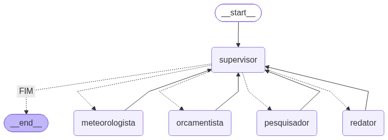

# Trabalho Prático 04 — Agentes Inteligentes

Assistente de planejamento de viagens construído como uma **equipe de agentes** coordenada por
um supervisor, em **LangGraph**, com o modelo gratuito `openai/gpt-oss-20b` servido pelo Groq.

## O problema

O usuário descreve a viagem que quer fazer e a equipe levanta o que for necessário —
informações sobre o destino, previsão do tempo, estimativa de custo — e devolve uma
recomendação.

O ponto central não é a aplicação em si, e sim **como ela decide o que fazer**: a ordem em que
os agentes trabalham não está escrita no código. Um supervisor lê o pedido e decide, a cada
rodada, qual especialista deve agir.

## Arquitetura



| Agente | Ferramenta | Papel |
|---|---|---|
| `pesquisador` | `buscar_destino` (Wikipédia) | história e atrações do destino |
| `meteorologista` | `consultar_clima` (Open-Meteo) | previsão e o que levar na mala |
| `orcamentista` | `calcular` | combustível, diárias, divisão de despesas |
| `redator` | — | consolida as contribuições na recomendação final |
| `supervisor` | — | decide quem age a cada rodada, ou encerra |

Cada especialista recebe **apenas as ferramentas do seu domínio**: o meteorologista não enxerga
a calculadora, o orçamentista não enxerga a Wikipédia. Nenhuma das três ferramentas exige chave
de API.

## Resultados

Três pedidos à mesma aplicação, sem alterar uma linha de código entre as execuções:

| Pedido | Rota escolhida pelo supervisor | Agentes |
|---|---|---|
| "O que tem para ver em Ouro Preto?" | `pesquisador → FIM` | 1 |
| "Vou a Tiradentes amanhã. Preciso levar guarda-chuva?" | `meteorologista → FIM` | 1 |
| "O que visitar, como estará o tempo e quanto gasto de combustível?" | `pesquisador → meteorologista → orcamentista → redator → FIM` | 4 |

No primeiro pedido a consulta de clima sequer foi feita — o supervisor julgou que não era
necessária. Um *pipeline* a teria executado de qualquer forma.

### O que aprendi construindo isto

**Delimitar o escopo de cada agente é tão importante quanto atribuí-lo.** Na primeira execução,
recebendo o pedido completo, o pesquisador respondeu também sobre clima e custo — e calculou o
combustível de cabeça, chegando a R$ 162,70 quando a ferramenta devolve R$ 162,67. Como a
resposta parecia cobrir tudo, o supervisor encerrou antes de acionar os demais especialistas.

A correção veio em duas frentes: restringir cada `system_prompt` com proibições explícitas
("NÃO fale sobre clima, custos ou valores") e reescrever a instrução do supervisor para
verificar o pedido parte por parte, considerando atendida apenas a porção coberta pelo
especialista daquele domínio.

O episódio ilustra uma característica do sistema: o LLM tende a responder tudo o que lhe
perguntam, mesmo fora do seu papel — e num arranjo multiagente isso quebra a divisão de
trabalho. O sintoma não aparece como erro de execução, mas como resposta plausível e incorreta.

**Agente ou pipeline?** O teste é direto: se eu tirar o LLM, o fluxo do programa muda? Num
pipeline, não — a sequência está no código. Aqui, sim — sem supervisor não há quem decida a
rota. O notebook inclui uma implementação em pipeline para comparação.

### Limitações

- A consulta meteorológica cobre apenas os três dias seguintes à execução
- Não há memória entre execuções — um `checkpointer` com `thread_id` resolveria
- Não há aprovação humana antes de ações sensíveis; o `interrupt` do LangGraph cobriria isso,
  e seria indispensável se alguma ferramenta efetivamente fizesse reservas

## Como executar

Abra `assistente_viagens.ipynb` no Google Colab. A primeira célula instala as dependências e a
segunda pede a chave do Groq, que é gratuita ([console.groq.com](https://console.groq.com)).

```bash
pip install langgraph langchain langchain-groq wikipedia
```

O notebook já vem com as saídas de uma execução completa, incluindo as três rotas e o grafo.

## Arquivos

| Arquivo | Descrição |
|---------|-----------|
| `assistente_viagens.ipynb` | Notebook com a aplicação, saídas e o grafo |
| `relatorio.pdf` | Relatório de uma página |
| `apresentacao_agentes.pptx` | Slides da apresentação |
